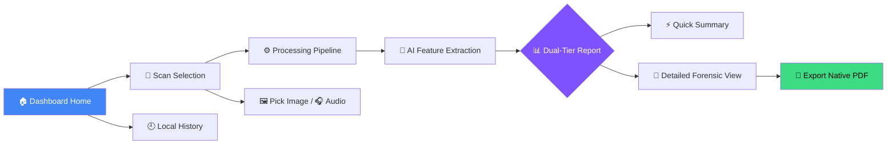
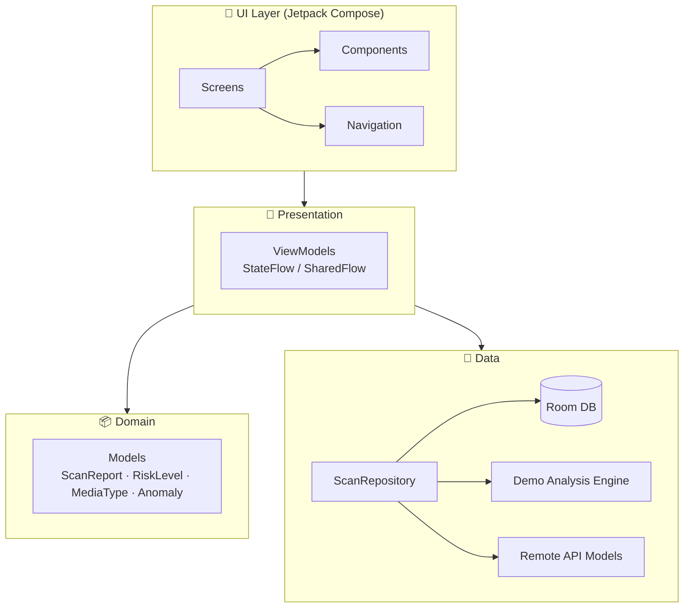

<div align="center">

<!-- Replace with your own logo: docs/images/logo.png -->
# 🛡️ CyberVerify

### **Detect. Verify. Stay Protected.**

*On-device deepfake detection, synthetic media analysis & forensic reporting for Android*

<br/>

[](https://kotlinlang.org/)
[](https://developer.android.com/jetpack/compose)
[](https://m3.material.io/)
[](https://developer.android.com/training/data-storage/room)
[](https://developer.android.com/)

[](#-license)
[](#-contributing)
[](#-getting-started)
[](#-author)

<br/>

[**Features**](#-key-features) •
[**Screens**](#-screen-previews) •
[**Architecture**](#-architecture) •
[**Getting Started**](#-getting-started) •
[**Roadmap**](#-roadmap) •
[**Contributing**](#-contributing)

</div>

---

## 📖 Table of Contents

- [Overview](#-overview)
- [Why CyberVerify?](#-why-cyberverify)
- [Key Features](#-key-features)
- [Screen Flow](#-screen-flow)
- [Screen Previews](#-screen-previews)
- [Architecture](#-architecture)
- [Tech Stack](#-tech-stack)
- [Getting Started](#-getting-started)
- [Testing](#-testing)
- [Roadmap](#-roadmap)
- [Contributing](#-contributing)
- [License](#-license)
- [Author](#-author)

---

## 🌐 Overview

**CyberVerify** is an Android app that helps people protect themselves against **synthetic media manipulation**, **deepfake visual artifacts**, and **generative audio spoofing**.

Built with a modern **Jetpack Compose** interface and a clean, testable architecture, it delivers forensic-style scanning, **dual-tier reports**, contextual AI safety assistance, and **on-device PDF export** — all with an offline-first design.

> 💡 **In one line:** pick an image or audio file → get an instant risk verdict → dig into the forensic details → export a shareable PDF certificate.

---

## 🎯 Why CyberVerify?

| ⚠️ The Problem | ✅ How CyberVerify Helps |
|---|---|
| AI-generated faces and voices are increasingly convincing | Flags visual and acoustic anomalies typical of synthetic media |
| Most detectors give a bare "real / fake" answer | Explains **why**, with a quick summary *and* a detailed forensic breakdown |
| Cloud tools require uploading private media | Designed for **offline, on-device** history and report generation |
| Results are hard to share or document | Exports a **timestamped PDF forensic certificate** |

---

## ✨ Key Features

### 🔍 1. Dual-Tier Forensic Reporting

<table>
<tr>
<td width="50%" valign="top">

#### ⚡ Quick Summary Tier
Instant, glanceable verdict:

- 🚦 Threat status: **Authentic · Low · Medium · High · Critical Synthetic**
- 📊 AI-manipulation confidence score
- 🎯 Top detected anomalies

</td>
<td width="50%" valign="top">

#### 🔬 Detailed Forensic Audit Tier
Full technical breakdown:

- 🌫️ Multi-spectral noise analysis & spatial artifact distribution
- 🧬 Generative-AI indicators (GAN boundary inconsistencies, facial feature distortion, frequency-spectrum anomalies)
- 🎙️ Audio spectrum inspection (phase jitter, synthetic pitch modulation, vocoder artifacts)
- 🗂️ EXIF & structural file-metadata validation

</td>
</tr>
</table>

### 📄 2. Native PDF Report Generator

- Generated fully **on-device** using Android's `PdfDocument` and `Canvas` rendering pipeline — no third-party PDF library needed.
- Shareable **forensic inspection certificates** with:
  - 🕒 Timestamped hashes
  - 📋 Complete anomaly breakdowns
  - 📈 Risk-classification meters
  - ✍️ Verification signatures

### 💾 3. Offline Room DB Persistence

- Offline-first history powered by **Room** + **Kotlin Coroutines / Flow**.
- 🔎 Instant search
- 🗃️ Filter by media category — **Image · Audio · Video**
- 🚨 Risk-severity indexing
- ♻️ Full report restoration with zero network dependency

---

## 🗺️ Screen Flow



---

## 📱 Screen Previews

> 📸 **Tip:** replace these ASCII mockups with real screenshots by adding images to `docs/screenshots/` and using a table like:
> `| Home | Report | PDF |` → ``

<details open>
<summary><b>🏠 Home Dashboard</b></summary>

```text
┌────────────────────────────────────────┐
│ 🛡️ CyberVerify             🔔  👤      │
├────────────────────────────────────────┤
│ ┌────────────────────────────────────┐ │
│ │  Overall Safety Index              │ │
│ │  ██████████████████░░ 88% SAFE     │ │
│ │  3 Total Scans | 1 Threat Detected │ │
│ └────────────────────────────────────┘ │
│                                        │
│  Quick Actions                         │
│ ┌──────────────┐      ┌──────────────┐ │
│ │ 📸 Scan Media│      │ 🤖 AI Safety │ │
│ └──────────────┘      └──────────────┘ │
│                                        │
│  Recent Analyses                       │
│ ┌────────────────────────────────────┐ │
│ │ 🖼️ portrait_test.jpg                │ │
│ │ 🚨 CRITICAL (94.2% Synthetic)      │ │
│ └────────────────────────────────────┘ │
└────────────────────────────────────────┘
```

</details>

<details open>
<summary><b>📊 Dual-Tier Forensic Report</b></summary>

```text
┌────────────────────────────────────────┐
│ ⬅️ Forensic Audit Report      📄 PDF    │
├────────────────────────────────────────┤
│ ┌────────────────────────────────────┐ │
│ │  Risk Level: CRITICAL SYNTHETIC    │ │
│ │  Score: 94.2% AI Manipulation      │ │
│ └────────────────────────────────────┘ │
│                                        │
│ ── [ Quick Summary ] ───────────────── │
│ • Facial Symmetry Anomaly (+92%)       │
│ • GAN Boundary Grid Pattern            │
│ • Inconsistent Lighting Vectors        │
│                                        │
│ ── [ Detailed Technical Breakdown ] ── │
│ 🔍 Noise Artifact Map                  │
│ 📈 Frequency Spectrum Analysis         │
│ 📑 Metadata Verification               │
│                                        │
│ ┌────────────────────────────────────┐ │
│ │ 📥 Download PDF Forensic Report    │ │
│ └────────────────────────────────────┘ │
└────────────────────────────────────────┘
```

</details>

### 🚦 Risk Levels at a Glance

| Level | Meaning |
|:---:|---|
| 🟢 **Authentic** | No meaningful signs of manipulation found |
| 🟡 **Low Risk** | Minor anomalies, likely benign |
| 🟠 **Medium Risk** | Several suspicious indicators — verify the source |
| 🔴 **High Risk** | Strong evidence of synthetic generation or editing |
| 🚨 **Critical Synthetic** | Overwhelming indicators of AI-generated content |

---

## 🏗️ Architecture

CyberVerify follows modern Android best practices: **MVVM + Clean Architecture** with **Unidirectional Data Flow (UDF)**.



<details>
<summary><b>📂 Project structure</b></summary>

```text
com.cyberverify
├── data
│   ├── demo              # Demo analysis engine & synthetic media generators
│   ├── local             # Room Database (AppDatabase, ScanDao, ScanEntity, Converters)
│   ├── remote            # Network models & API service interfaces
│   └── repository        # ScanRepository implementation with Flow data streams
├── domain
│   └── model             # Core domain models (ScanReport, RiskLevel, MediaType, Anomaly)
├── presentation
│   └── viewmodel         # ScanViewModel, HistoryViewModel, HomeViewModel, AuthViewModel
├── ui
│   ├── component         # Reusable M3 Composables (AudioPlayerCard, MediaPicker, ImagePreview)
│   ├── navigation        # Compose Navigation routes & graph definition
│   ├── screen            # Home, Scan, Processing, QuickSummary, DetailedReport, History, Profile
│   └── theme             # Material 3 Expressive theme, typography & dynamic palette
└── util                  # PdfReportGenerator, FileMetadataExtractor, AudioPlaybackManager
```

</details>

---

## 🛠️ Tech Stack

| Category | Technology |
|---|---|
| 💻 **Language** | [Kotlin](https://kotlinlang.org/) — 100% idiomatic Kotlin |
| 🎨 **UI** | [Jetpack Compose](https://developer.android.com/jetpack/compose) + Material Design 3 Expressive |
| 🏛️ **Architecture** | MVVM · Clean Architecture · StateFlow / SharedFlow |
| 💾 **Database** | [Room](https://developer.android.com/training/data-storage/room) with TypeConverters for complex metadata |
| ⚡ **Concurrency** | Kotlin Coroutines + Flow |
| 📄 **Media & Docs** | Android `PdfDocument` / `Canvas`, `MediaPlayer` |
| 🔧 **Build** | Gradle Version Catalogs (`libs.versions.toml`) · AGP 8.x |

---

## 🚀 Getting Started

### ✅ Prerequisites

| Requirement | Version |
|---|---|
| 🧰 Android Studio | Jellyfish (2023.3.1) or newer |
| ☕ JDK | 17+ |
| 📱 Device / Emulator | Android 8.0 (API 26)+ |

### 📥 Installation

```bash
# 1️⃣ Clone the repository
git clone https://github.com/sangmeshwar2006/cyberverify.git
cd cyberverify

# 2️⃣ Build the debug APK
./gradlew assembleDebug

# 3️⃣ (Optional) Install directly on a connected device
./gradlew installDebug
```

Or open the folder in **Android Studio** (`File ▸ Open…`), let Gradle sync, and press ▶️ **Run**.

> 📦 The debug APK is generated at `app/build/outputs/apk/debug/app-debug.apk`.

---

## 🧪 Testing

The test suite covers ViewModels, risk-assessment logic, and file-metadata parsing.

```bash
# Run all unit tests
./gradlew test

# Run debug unit tests only
./gradlew testDebugUnitTest

# Run a specific test class
./gradlew test --tests "com.cyberverify.ScanViewModelTest"
```

---

## 🗓️ Roadmap

- [x] Dual-tier forensic reports (Quick Summary + Detailed Audit)
- [x] Native on-device PDF export
- [x] Offline history with Room + search & filters
- [x] Material 3 Expressive UI
- [ ] Production ML model integration (TensorFlow Lite / ONNX)
- [ ] Full video deepfake analysis
- [ ] Batch scanning
- [ ] Report sharing with QR-based verification
- [ ] Localization (multi-language support)
- [ ] CI pipeline with automated tests & lint

> 💬 Have an idea? [Open an issue](https://github.com/sangmeshwar2006/cyberverify/issues) — suggestions are welcome!

---

## 🤝 Contributing

Contributions make open source great! To contribute:

1. 🍴 **Fork** the repository
2. 🌿 Create a feature branch: `git checkout -b feature/amazing-feature`
3. 💾 Commit your changes: `git commit -m "Add amazing feature"`
4. 📤 Push to the branch: `git push origin feature/amazing-feature`
5. 🔃 Open a **Pull Request**

Please make sure `./gradlew test` passes before submitting.

---

## 📜 License

Distributed under the **MIT License**. You are free to use, modify, and distribute this software, provided the copyright notice and license text are included.

```text
MIT License

Copyright (c) 2026 Sangmeshwar

Permission is hereby granted, free of charge, to any person obtaining a copy
of this software and associated documentation files (the "Software"), to deal
in the Software without restriction, including without limitation the rights
to use, copy, modify, merge, publish, distribute, sublicense, and/or sell
copies of the Software, and to permit persons to whom the Software is
furnished to do so, subject to the following conditions:

The above copyright notice and this permission notice shall be included in all
copies or substantial portions of the Software.

THE SOFTWARE IS PROVIDED "AS IS", WITHOUT WARRANTY OF ANY KIND, EXPRESS OR
IMPLIED, INCLUDING BUT NOT LIMITED TO THE WARRANTIES OF MERCHANTABILITY,
FITNESS FOR A PARTICULAR PURPOSE AND NONINFRINGEMENT. IN NO EVENT SHALL THE
AUTHORS OR COPYRIGHT HOLDERS BE LIABLE FOR ANY CLAIM, DAMAGES OR OTHER
LIABILITY, WHETHER IN AN ACTION OF CONTRACT, TORT OR OTHERWISE, ARISING FROM,
OUT OF OR IN CONNECTION WITH THE SOFTWARE OR THE USE OR OTHER DEALINGS IN THE
SOFTWARE.
```

---

## 👤 Author

**Sangmeshwar**

[](https://github.com/sangmeshwar2006)

---

<div align="center">

### ⭐ If CyberVerify helps you, please give it a star!

**Built with ❤️ for Digital Media Integrity & Cyber Safety**

<sub>Detect · Verify · Stay Protected</sub>

</div>
